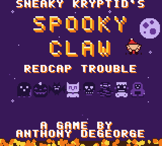
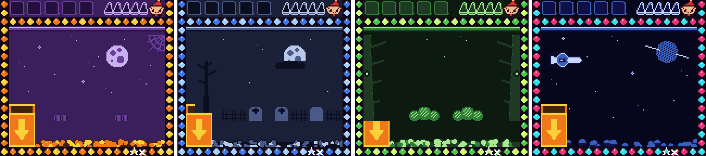

<div align="center">

# 🎃 Sneaky Kryptid's Spooky Claw 🦇

### Beat **Lil Redcap** across four haunted worlds. A Game Boy Color game for the ModRetro Chromatic.

[](https://ant-degeorge.github.io/sneaky-kryptids-spooky-claw/)
[](docs/spooky_claw3.gbc)



</div>

## The game
Slide the claw, drop it on the glowing prize, and fill your 5 pockets before Redcap fills his 5 caps. Built for a 5-year-old and a 4-year-old player, so it is gentle at first and gets sneakier as the worlds go on.

| World | New trick |
|---|---|
| 🎃 **1 · Pumpkin Patch** | Redcap scoots prizes out of reach |
| 🪦 **2 · Graveyard** | Tombstones: crack the stone, then grab the prize. Redcap sneaks. |
| 🦇 **3 · Haunted Forest** | Bats knock the claw sideways. Wait for them to pass. |
| 🚀 **4 · Outer Space** | Low gravity, floaty claw, Space Redcap with a jetpack |



- ⭐ **5-star ranks** after every level: 5 − caps Redcap filled + sneaks you bonked (40 stars total)
- 🟡 **Golden claw** turns: easy grab, steals one back, or takes two
- 😈 **Bonk the sneak**: tap A fast when Redcap creeps toward your pockets
- 🎉 **Custom ending**: a parade for each of two players, then YOU WON
- 💾 **Saves progress** after every star screen when the cartridge has save memory

## Play it
- **Browser:** https://ant-degeorge.github.io/sneaky-kryptids-spooky-claw/ (keyboard or on-screen buttons, works on phones)
- **Emulator:** any Game Boy Color emulator, load `docs/spooky_claw3.gbc`
- **Real hardware:** see below

### Controls
| Button | Action |
|---|---|
| D-pad ◀ ▶ | Move the claw |
| A or B | Drop the claw / shoo Redcap |
| START | Start / continue |
| B + A on the title | New game |
| SELECT | Music on/off |

## Put it on a cartridge (ModRetro Chromatic)
1. Handheld: **SYSTEM → C. MAGICIAN = ON**.
2. In ChroMagician, **back up the Tetris cart first**. Writing homebrew replaces it.
3. **Write Homebrew** → `spooky_claw3.gbc` → wait for write and verify.
4. **C. MAGICIAN = OFF**, power-cycle.
5. If it will not boot, write `spooky_claw3_nosave.gbc` instead.

## Build it
Needs [GBDK-2020](https://github.com/gbdk-2020/gbdk-2020) 4.5.0 and Python 3 with Pillow.

```sh
make GBDK_HOME=/path/to/gbdk     # Linux / macOS / WSL
build.bat                        # Windows, GBDK at C:\gbdk
```

Outputs `build/spooky_claw3.gbc` (MBC5 + battery, header `0x1B`) and `build/spooky_claw3_nosave.gbc` (plain MBC5, `0x19`). 64 KB, CGB-only.

| Path | What |
|---|---|
| `src/main.c` | The whole game (ROM bank 1). Difficulty tables at the top. |
| `src/main0.c`, `src/loader.c` | ROM0 entry and bank-safe loaders |
| `src/sound.c`, `src/sound_data.c` | Two-channel music engine plus SFX |
| `tools/art.py`, `tools/gen_assets.py` | ASCII pixel art to tiles, maps, palettes |
| `tools/gen_sound.py` | Songs as note strings |
| `tools/kidbot3.py`, `tools/scen3.py` | PyBoy balance bot and screenshot scenarios |

## Balance (bot-measured, "average kid")
| Level | Win rate | Avg stars |
|---|---|---|
| W1-1 / W1-2 | 100% / 100% | 4.6 / 4.8 |
| W2-1 / W2-2 | 100% / 100% | 4.3 / 4.8 |
| W3-1 / W3-2 | 69% / 67% | 3.6 / 3.4 |
| W4-1 / W4-2 | 83% / 100% | 4.2 / 3.7 |

World 3 is the hump on purpose: waiting for the bat to pass is the skill it teaches.

## Credits
A game by **Anthony DeGeorge** · Part of the *Kryptids in Space* universe.
Browser player uses [WasmBoy](https://github.com/torch2424/wasmBoy) (GPL-3.0), vendored in `docs/vendor/`.
Built with GBDK-2020.
